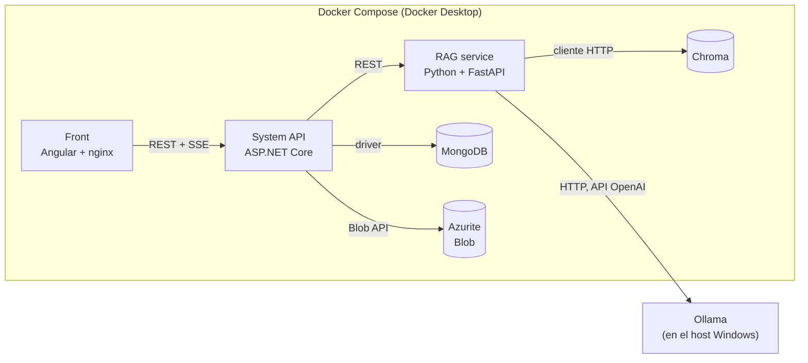

# RunbookAI (nombre provisorio)

Proyecto de práctica para entender la arquitectura de productos con IA. Es un sistema donde se suben documentos (markdown, PDF) y después se les hacen preguntas, usando RAG: se recuperan los fragmentos más relevantes y un LLM responde con ellos citando las fuentes.

Se desarrolla 100% en local con Docker Desktop, y está pensado para poder llevarse después a Azure / AKS.

## Cómo trabajar conmigo

- Soy desarrollador (4to año de Ingeniería en Sistemas). No hace falta explicar lo básico de programación.
- **Antes de implementar algo, explícame cómo lo vas a hacer y espera mi confirmación.**
- **Avísame antes cuando te estés quedando sin espacio de contexto en la conversación.**
- Trabajo en Azure (AKS, Key Vault, Blob, etc.). Cuando haya un equivalente, habla en términos de Azure.
- Estoy aprendiendo: explica el porqué de las decisiones, no solo el qué.
- Trabajamos **una fase por sesión** (ver "Plan por fases"). No avances a la siguiente fase sin avisarme.
- Cada fase termina cumpliendo su criterio "Lista cuando", y con un commit.
- Comunícate en español.

## Entorno de desarrollo

- Windows (x64), AMD Ryzen 7 5700X (8 núcleos), 16 GB de RAM, AMD Radeon RX 7600 con 8 GB de VRAM.
- Discos: SSD de 954 GB, SSD de 112 GB y HDD de 932 GB. Verificar cuál es `C:`.
- Docker Desktop con backend WSL2.
- **Ollama corre directamente en Windows, NO en contenedor.** Docker Desktop no le pasa la GPU AMD a los contenedores (su doc solo menciona NVIDIA), y en contenedor correría solo en CPU.
- Los contenedores llegan a Ollama por `http://host.docker.internal:11434`. Si no conecta, configurar Ollama con `OLLAMA_HOST=0.0.0.0`.
- Cuidados: limitar la memoria de WSL con `.wslconfig` (unos 6 a 8 GB), mover la ubicación del disco de Docker al SSD grande y definir `OLLAMA_MODELS` apuntando al SSD grande. Evitar el HDD.
- Con 8 GB de VRAM, apuntar a LLMs de unos 7 a 8B parámetros cuantizados a 4 bits, con buen español. Para embeddings, un modelo multilingüe (por ejemplo bge-m3, verificar que esté en Ollama y su dimensión).

## Stack

| Componente | Tecnología | Responsabilidad |
|---|---|---|
| Front | Angular (SPA estática, nginx en contenedor) | Subir documentos, ver su estado, chat con streaming y fuentes |
| System API | ASP.NET Core (.NET LTS vigente) con OpenAPI | Dueña de los documentos originales, el registro de documentos y las conversaciones. Orquesta al RAG service |
| RAG service | Python + FastAPI | Ingesta (chunking + embeddings), retrieval y generación. Único que habla con Chroma y con Ollama |
| Base de datos | MongoDB | Colecciones `documentos`, `conversaciones`, `mensajes` |
| Storage | Azurite (emulador de Azure Blob) | Archivos originales |
| Base vectorial | Chroma (modo servidor, contenedor propio) | Chunks, vectores y metadata. Es un índice derivado |
| Modelos | Ollama (en el host Windows) | LLM de chat y embeddings, con API compatible con OpenAI |
| Orquestación | Docker Compose | Seis contenedores: front, system-api, rag-service, mongo, azurite, chroma |

## Arquitectura

### Flujo de ingesta

1. El front sube el archivo a la System API.
2. La System API lo guarda en Azurite, crea el registro en MongoDB (estado `pending`, con hash) y responde de inmediato.
3. La System API pasa el documento a `indexing` y se lo manda al RAG service (`/ingest`).
4. El RAG service extrae el texto, genera chunks, pide los embeddings a Ollama y los guarda en Chroma con su metadata.
5. La System API actualiza el estado a `indexed` (o `error` con el detalle). El front hace polling de la lista de documentos.

### Flujo de pregunta

1. El front manda la pregunta a la System API.
2. La System API guarda el mensaje del usuario, carga los últimos N mensajes y llama al RAG service (`/ask`) con pregunta, namespace e historial.
3. El RAG service genera el embedding de la pregunta, busca los top-k chunks en Chroma (con filtro de namespace), arma el prompt con el contexto y el historial, y genera la respuesta con Ollama.
4. El RAG service devuelve respuesta, fuentes (documento, página, chunk, distancia), modelo y tokens, en streaming.
5. La System API reenvía el stream al front (SSE) y al terminar guarda el mensaje del asistente con sus fuentes en MongoDB.

## Decisiones de diseño

- **Cliente liviano y desacoplado:** el front solo presenta y llama a la API. Nginx sirve la SPA y hace de proxy hacia la System API (evita CORS). Sin SSR.
- **La System API es dueña de todo el estado del producto** (documentos, registro, conversaciones). El RAG service no guarda nada propio salvo Chroma, que se puede reconstruir reingestando los originales.
- **Separación System API / RAG service:** es el desacople principal, con contrato HTTP definido por OpenAPI. Pensado para poder desplegarlos por separado más adelante.
- **Sin adapters por ahora.** El RAG service usa Chroma y el SDK de `openai` directamente. Introducir adapters solo cuando aparezca un segundo proveedor real.
- **Pasar a OpenAI / Azure OpenAI después:** el RAG service usa el SDK de `openai` apuntando a Ollama. Cambiar de proveedor debe ser configuración (URL, clave, nombre de modelo). Sin PyTorch en el RAG service.
- **Cambiar el modelo de embeddings obliga a reindexar:** cada colección de Chroma guarda en su metadata el nombre del modelo de embeddings y la dimensión. Cambiar de modelo = colección nueva + reingesta desde los originales en Blob.
- **Una sola base por ahora:** MongoDB. Se agrega Postgres solo si aparecen relaciones reales (usuarios, permisos).
- **Usuarios:** fuera de alcance por ahora. Si se agregan, usar Microsoft Entra ID y guardar solo el id del usuario como referencia.

## Modelo de datos

### MongoDB

**`documents`**: `id` (uuid), `title`, `originalFileName`, `blobName`, `namespace`, `sizeBytes`, `hash` (SHA-256), `version`, `status` (`pending` | `indexing` | `indexed` | `error` | `deleted`), `errorDetail`, `chunkCount`, `createdAt`, `updatedAt`, `indexedAt`.

**`conversations`**: `id` (uuid), `userId`, `title`, `namespace`, `createdAt`.

**`messages`** (colección aparte, índice por `conversationId` + `createdAt`): `id` (uuid), `conversationId`, `role` (`user` | `assistant`), `content`, `createdAt`. Solo en respuestas del asistente: `sources` (lista de `{documentId, chunkId, page, distance}`), `model`, `inputTokens`, `outputTokens`.

### Chroma

Un registro por chunk: `id`, vector, texto del chunk y metadata `{documentId, title, page, order, namespace, docHash}`. Los filtros por namespace usan esta metadata, por eso debe existir desde la ingesta.

## Contratos (propuesta, a refinar en las fases 2 y 4)

**RAG service:** `GET /health`, `POST /ingest`, `DELETE /documents/{id}` (borra los chunks de un documento), `POST /ask` (con streaming).

**System API:** subir, listar y borrar documentos; crear y listar conversaciones; enviar mensaje (con streaming SSE).

Borrar un documento implica tres cosas: borrar el archivo en Azurite, borrar sus chunks en Chroma (vía el RAG service) y marcar el registro como `deleted`.

## Convenciones

- **Identificadores en inglés de punta a punta:** código, contratos JSON/OpenAPI, campos y colecciones de Mongo, metadata de Chroma, valores de enums y logs. En español solo lo que lee el usuario final (textos de la UI, respuestas del LLM, mensajes de error mostrados).
- **Casing:** cada lenguaje usa su convención (`snake_case` en Python, `PascalCase` en C#, `camelCase` en TypeScript) y el JSON va siempre en `camelCase`. La conversión se configura una sola vez por servicio (alias generator de Pydantic, serializador de ASP.NET), nunca campo por campo.
- **Tests:** `pytest` en el RAG service. Unitarios para funciones puras (chunking, prompt, IDs) e integración (`@pytest.mark.integration`) contra Chroma y Ollama reales, que se saltean si no están disponibles. Sin mocks del LLM: la calidad se mide con el set de evaluación (Fase 3).
- **Python:** dependencias y venv con `uv` (`pyproject.toml` + `uv.lock` versionado).
- Los contratos entre servicios se definen con OpenAPI. Clientes generados con NSwag (TypeScript para Angular, C# hacia el RAG service; Kiota es alternativa).
- IDs estables (uuid) en todos los documentos, mensajes y chunks. Las referencias entre colecciones y sistemas son por id.
- Dentro de la red de Compose, los servicios se llaman por nombre (`http://rag-service:8000`, `http://chroma:8000`, `azurite:10000`). Fuera de Docker, `localhost`.
- Azurite: dentro de Compose, usar el endpoint `azurite:10000` en la cadena de conexión. `UseDevelopmentStorage=true` solo sirve fuera de Docker.
- Configuración por variables de entorno. `.env` no se versiona; `.env.example` sí. Ningún secreto en el repositorio.
- Cada `/ask` registra en logs la pregunta, los chunks recuperados y sus distancias.
- Datos persistentes (MongoDB, Chroma, Azurite) en volúmenes de Docker.

## Plan por fases

**Fase 0: preparar el entorno (Windows).** Instalar o actualizar drivers de AMD, Ollama, Docker Desktop (WSL2), .NET SDK, Node con Angular CLI, Python y Git. Configurar `.wslconfig`, disco de Docker y `OLLAMA_MODELS`. Opcional: LazyDocker. *Lista cuando:* un modelo de 7-8B responde en Ollama usando la GPU, y Docker corre un contenedor de prueba.

**Fase 1: infraestructura base.** Repositorio con `frontend/`, `system-api/`, `rag-service/`, `docker-compose.yml`, `.env.example`. Compose con MongoDB, Azurite y Chroma con volúmenes. Descargar el LLM y el modelo de embeddings. *Lista cuando:* los tres contenedores están sanos y un contenedor llega a Ollama por `host.docker.internal`.

**Fase 2: RAG service solo.** FastAPI con `/health`, `/ingest` y `/ask` sobre archivos markdown. Embeddings y LLM por Ollama con el SDK de `openai`. Guardar modelo y dimensión en la metadata de la colección de Chroma. Logs de retrieval. *Lista cuando:* subes un runbook, preguntas y la respuesta cita sus fuentes, y puedes inspeccionar lo guardado en Chroma.

**Fase 3: calidad del RAG.** Lectura de PDF, chunking por títulos, metadata completa, filtro por namespace, prompt con grounding (responder solo con el contexto o decir que no sabe). Set de evaluación de 15 a 20 preguntas con un script que lo corre. *Lista cuando:* hay una evaluación base guardada y se puede medir el efecto de cambiar tamaño de chunk, `k` y prompt.

**Fase 4: System API, documentos.** ASP.NET Core con OpenAPI y MongoDB. Subir (a Azurite y al registro, con hash y estado), listar y borrar, llamando al RAG service. Cliente generado del contrato del RAG service. Agregar `DELETE /documents/{id}` al RAG service. *Lista cuando:* subes desde Swagger y el estado pasa a `indexado`, y borrar limpia Azurite, MongoDB y Chroma.

**Fase 5: conversaciones.** Colecciones `conversaciones` y `mensajes`, historial enviado al RAG service, fuentes guardadas por respuesta, streaming de punta a punta. *Lista cuando:* una pregunta de seguimiento se entiende en contexto y el streaming funciona con `curl`.

**Fase 6: front Angular.** Cliente generado con NSwag. Pantallas de documentos (subida y estado con polling) y de chat (streaming y fuentes). Nginx como proxy. *Lista cuando:* el flujo completo funciona desde el navegador.

**Fase 7: dockerizar y cerrar.** Dockerfiles de las tres aplicaciones, Compose completo con healthchecks y `depends_on`, README para levantarlo. Diagramas UML en `docs/`. *Lista cuando:* `docker compose up` lo levanta todo, con Ollama en el equipo.

**Fase 8: evolución (de a una, opcional).** Pasar a OpenAI o Azure OpenAI y reindexar; búsqueda híbrida con reranking; usuarios con Entra ID (y Postgres si aparecen relaciones); ingesta asíncrona con cola (Azurite Queue Storage); observabilidad (OpenTelemetry); llevarlo a AKS (manifiestos, Key Vault, Blob real, Azure AI Search).

## Pendientes por definir

- **Nombre del proyecto:** "RunbookAI" es provisorio. Se cambia más adelante.
- **Modelos concretos** (LLM y embeddings): se eligen en las fases 0 y 1, verificando la disponibilidad y la dimensión del modelo de embeddings en Ollama.
- **Versiones de herramientas:** se verifican en la Fase 0.

## Fuera de alcance por ahora

Autenticación y usuarios, ingesta asíncrona con cola, búsqueda híbrida y reranking, despliegue en la nube.
